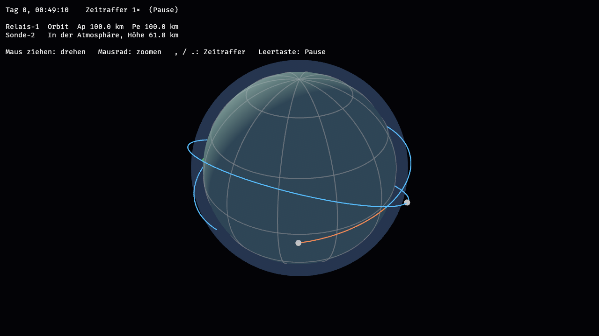

# Kepler Industries

*Arbeitstitel.* Eine Wirtschaftssimulation in der Kartenansicht: Bahnen planen,
Fracht transportieren, Satellitennetze aufbauen, Basen gründen und alles am
Laufen halten. Geschrieben in Rust mit [Bevy](https://bevy.org).

Warum der Code so aufgebaut ist, steht in [`docs/ARCHITEKTUR.md`](docs/ARCHITEKTUR.md).

## Stand

Fundament: ein Planet mit Atmosphäre, eine Startbasis, zwei Satelliten.
„Relais-1" kreist stabil oberhalb der Atmosphäre. „Sonde-2" wurde zu tief
abgesetzt, wird bei jedem Durchgang durch die Luft abgebremst (orange) und
stürzt nach einigen Umläufen als Wrack ab.



## Starten

Voraussetzung: Rust ≥ 1.97.1 (`rustup update`). Unter Linux die
[Systempakete für Bevy](https://github.com/bevyengine/bevy/blob/main/docs/linux_dependencies.md)
(Audio- und Gamepad-Pakete werden nicht gebraucht).

```sh
cargo run -p game
```

Der erste Build dauert einige Minuten, danach geht es schnell.

### Steuerung

| Eingabe | Wirkung |
|---|---|
| Maus ziehen (links oder rechts) | Kamera drehen |
| Mausrad | Zoomen |
| `.` / `,` | Zeitraffer schneller / langsamer (1× bis 100 000×) |
| Leertaste | Pause |

### Optionen

```sh
cargo run -p game -- --time 7200 --camera 30,20,2500 --screenshot bild.png
```

- `--time SEKUNDEN`: vor dem Start bis zu dieser Spielzeit vorrechnen
- `--camera GIER,NEIGUNG,KM`: Blickwinkel in Grad, Abstand vom Planetenmittelpunkt in km
- `--screenshot DATEI.png`: Bild speichern und beenden (Zeit steht dabei still)

## Tests

```sh
cargo test -p sim
```

Die Simulation hat keine Abhängigkeit zu Bevy, die Tests kompilieren und laufen
in Sekunden.

## Aufbau

- `crates/sim`: Simulation (Bahnen, Atmosphäre, Zeitleiste, Spielstand)
- `crates/game`: Darstellung und Eingabe mit Bevy
- `docs/ARCHITEKTUR.md`: Regeln, Physikmodell, Entscheidungen, Merkliste
