# Kepler Industries

*Arbeitstitel.* Eine Wirtschaftssimulation in der Kartenansicht: Bahnen planen,
Fracht transportieren, Satellitennetze aufbauen, Basen gründen und alles am
Laufen halten. Geschrieben in Rust mit [Bevy](https://bevy.org).

Warum der Code so aufgebaut ist, steht in [`docs/ARCHITEKTUR.md`](docs/ARCHITEKTUR.md).

## Stand

Die Sonne Zunn mit zwei Planeten: Zorb, Heimat der Zorbels, mit Atmosphäre
und den Monden Zoon und Zill, weiter draußen Nura.

**Spielbeginn:** Es gibt nur die Startbasis auf Zorb mit 3 t Zorit im Lager
und keine Schiffe. Der Vorrat reicht genau für eine Basis: ein Basisschiff,
ein Frachter und 4 t Bauteile (der Frachter fliegt dafür zweimal). Bestellt
wird in der Karte „Startbasis" der Seitenleiste; sie ist zu Beginn offen.
Eine Absicherung gibt es nicht: Wer mit dem Vorrat keine Mine fertig bekommt
(etwa als Erstes eine Tankstelle baut oder ein Schiff verliert), steckt fest.

**Demo (`--demo`):** Zum Ausprobieren und für alle Beispiele in diesem README,
die Schiffe mit Nummer nennen (`--node`, `--select`, `--launch`, `--target`
und so weiter), lädt `cargo run -p game -- --demo …` statt des Spielbeginns
eine Welt mit Schiffen, weiteren Zielgebieten und leerem Lager: zwei
Satelliten mit Triebwerk, eine Fähre am Boden und eine im Orbit, dazu zwei
Basisschiffe und zwei beladene Frachter. „Relais-1" kreist stabil oberhalb
der Atmosphäre. „Sonde-2" wurde zu tief abgesetzt, wird bei jedem Durchgang
durch die Luft abgebremst (orange) und stürzt nach einigen Umläufen ab, außer
man rettet sie mit einem Manöver. „Fähre-3" steht an der Startbasis und kann
starten. „Mondfähre-4" kreist vollgetankt in 100 km Höhe über dem Äquator,
bereit für den Flug zum Mond.

**Fracht und Basen (der Kreislauf der Wirtschaft):** Es gibt drei Stoffe:
Bauteile und Zorit (ein Erz, das es auf Zorb nicht gibt) sind Fracht und
teilen sich den Frachtraum, Treibstoff liegt im Tank. Fracht zählt als Masse
(weniger Δv, zu sehen am Δv-Balken). Alles läuft über die Karte „Fracht &
Basis" der Seitenleiste.

- **Startbasis:** Schiffe in ihrem Zielgebiet laden Bauteile, tanken und
  laden Zorit ab; das Zorit kommt in ihr Lager. Die Karte „Startbasis"
  (ein Schiff dort oder ihr Zielgebiet gewählt) zeigt das Lager und bestellt
  neue Schiffe, die sofort vollgetankt dort stehen.
- **Preise in Zorit:** Basisschiff 1 t, Frachter 1 t, Bauteile 0,25 t je
  Tonne; Treibstoff ist an der Startbasis frei. Eine neue Basis kostet damit
  2 t Zorit.
- **Gründen:** Ein Basisschiff, das auf einem Körper außer Zorb gelandet ist,
  gründet dort eine **Mine** oder eine **Tankstelle** und wird ihr Fundament
  (es fliegt dann nicht mehr). Der Landepunkt wird zur Zone mit 5 km Radius,
  sichtbar wie jedes Zielgebiet, auch in der Vorschau der Landung.
- **Baustelle:** Sie braucht 4 t Bauteile; Frachter, die in der Zone landen,
  laden dort ab.
- **Tankstelle:** stellt Treibstoff her (180 kg pro Stunde, Lager 8 t);
  Schiffe in der Zone tanken.
- **Mine:** baut Zorit ab (100 kg pro Stunde); Frachter in der Zone laden es.
  Wie viel ihr Lager fasst, hängt vom Körper ab (Zoon 1 t, Zill 2 t, Nura
  4 t): Das ist die Menge pro Abholung. Weil Vorspulen nichts kostet, zählt
  der Ertrag pro Flug, nicht pro Stunde.

Frachter (2 t Frachtraum) und Basisschiff starten voll beladen von Zorb und
kommen bis Zoon; der Frachter kommt von dort ohne Tanken mit Zorit zurück
(auf Zorb bremsen Luft und Fallschirm). Zum schnellen Ausprobieren kreisen
in der Demo schon Schiffe um Zorb, hinter Mondfähre-4: „Basisschiff-5",
„Basisschiff-6" und die Frachter „Frachter-7" und „Frachter-8" mit je 2 t
Bauteilen. Alle vier direkt nach Zoon:
`--demo --node 5,600,845,0,0 --node 6,620,845,0,0 --node 7,610,845,0,0 --node 4,647.5,845,0,0`;
Basisschiff-5 und beide Frachter landen nach knapp 8 Stunden nebeneinander
bei 153° Ost, Basisschiff-6 bei 157° West (mit `--time 28300` stehen sie
schon dort).

Gestartet wird mit einem Startprofil aus vier Werten: Kurs, Wendebeginn,
Wendewinkel (so weit neigt sich das Schiff beim Wendebeginn aus der
Senkrechten) und Ziel-Apoapsis. Eingestellt wird es in der Karte „Start“ der Seitenleiste
rechts, die erscheint, sobald ein gelandetes Schiff gewählt ist. Die
Voreinstellung hängt vom Körper ab: mit Luft (Zorb) Wende ab 1,5 km mit 10°,
Ziel 100 km; ohne Luft (Zoon) ab 100 m mit 70°, Ziel 30 km. Die Vorschau zeigt den ganzen
Aufstieg (gelb) und die Bahn danach. Den Node zum Zirkularisieren an der
Apoapsis kann man schon vor dem Abheben setzen.

Gelandet wird über einen Node, der die Bahn in die Luft führt. Die Vorschau
rechnet bis zum Boden, mit Fallschirm (unter 3 km). Ein Kreuz zeigt, wo das
Schiff aufsetzt: grün im Zielgebiet (grüne Kreise), gelb außerhalb, rot bei
einem Absturz. Das letzte Stück fliegt das Schiff selbst: Käme es schneller
als 5 m/s am Boden an, zündet es vorher automatisch ein Landebrennen (gelb auf
der Bahn, „Landen“ im Δv-Balken), voller Schub gegen die Bewegung zum Boden,
so spät, dass es knapp über dem Boden zum Stehen kommt. Das braucht Schub
größer als das Gewicht und genug Treibstoff; sonst wird gar nicht gebremst und
das Schiff stürzt ab. Wer daneben landet, kommt mit einem Hop ins Ziel: einem Start mit
niedriger Ziel-Apoapsis, zum Beispiel von der Startbasis zum Übungsfeld 60 km
östlich (Kurs 90°, Ziel-Apoapsis etwa 27 km). Relais-1 und Sonde-2 sind
Satelliten ohne Fallschirm und mit weniger Schub als Gewicht: Sie stürzen beim
Landen immer ab. Die Anzeige nennt dann Ort (auch das Zielgebiet) und Grund.

Für den Flug zu einem Planeten oder Mond wählt man ihn in der Karte „Ziel“
(mit ◄ ► nach den Schiffen). Sie zeigt den Phasenwinkel und wann das nächste
Startfenster kommt (ein Richtwert aus der Hohmann-Formel, für Nura etwa 44°),
dazu die engste Annäherung der geplanten Bahn an das Ziel, auch wenn sie
seine Einflusssphäre noch verfehlt; in der Karte markieren zwei Ringe mit
Linie die Stelle. So sieht man beim Ziehen am Node, ob es besser wird, bis
aus „Annäherung“ eine „Begegnung“ mit Periapsis wird. Zum Ausprobieren:
`--demo --select 3 --target-body 3,4 --node 3,163400,1080,0,0 --focus-body 0
--camera 30,60,55000000` verfehlt Nura um 126.000 km; mit 1.090 m/s trifft es.

Für ein Rendezvous wählt man in der Karte „Ziel“ der Seitenleiste ein
anderes Schiff (◄ ►). Dessen Bahn wird rosa. Die Karte zeigt den Abstand,
die engste Annäherung (wann, wie nah, wie schnell relativ zueinander) und die
Neigung zur Bahnebene des Ziels. Gesucht wird bis vier Umläufe nach dem
letzten geplanten Manöver, also auch auf den geplanten Bahnen. Auf der Karte
markieren zwei Ringe mit einer Linie die Annäherung, Rauten mit „AN“/„DN“
die Knoten, an denen ein Node die Bahnebene angleicht. Liegen beide Bahnen in
derselben Ebene (wie nach dem Abdocken), steht dort „gleiche Ebene“, und es
gibt keine Knoten. Am Boden gilt das für
die Bahn nach dem geplanten Start: Startzeit und Kurs so lange verschieben,
bis die Neigung klein ist, ergibt das Startfenster.

Liegt die engste Annäherung unter 1 km, dockt man mit „Andocken bei
Annäherung“ in der Karte „Ziel“ an. Die Kette bekommt dann einen
automatischen Node „Angleichen“ (doppelter rosa Ring): Er hebt an der engsten
Stelle die Relativgeschwindigkeit auf. Danach fliegt das Schiff auf gerader
Linie langsam ans Ziel heran (höchstens 2 m/s, Kontakt mit 0,1 m/s). Die
Karte zeigt Zeiten und Δv, der Δv-Balken die Kosten in Rosa. Beim Kontakt
werden die Schiffe ein Verbund („Relais-1 + Fähre-3“): Massen, Tanks und
Triebwerke addieren sich, und der Verbund kann normal Manöver fliegen. Das
Ziel muss dafür auf einer stabilen Bahn sein und darf nichts mehr planen.

Abgedockt wird in der Karte „Verbund“: Teil wählen (◄ ►), mit − / + einstellen,
wie viel Treibstoff es mitnimmt (vorgeschlagen ist eine Aufteilung nach
Tankgröße, `Umschalt`: feine Schritte), darunter steht, was beide danach haben.
„Abdocken“ trennt sofort; das abgedockte Schiff bekommt 1 m/s gegen die
Flugrichtung und entfernt sich stetig (in 100 km Höhe etwa 6 km pro Umlauf).
Es hat danach das Hauptschiff als Ziel, zum Wiederandocken. So lässt sich zum
Beispiel ein Satellit betanken.

Der Mond Zoon ist wie der Mun in KSP: 200 km Radius, Schwerkraft 1,63 m/s², keine
Luft. Er kreist in 12.000 km Abstand über dem Äquator (Umlauf etwa 38,6 h) und
zeigt dem Planeten immer dieselbe Seite. Um ihn liegt seine Einflusssphäre
(etwa 2.430 km, gestrichelter Kreis): Darin zählt nur seine Schwerkraft, außerhalb
nur die des Planeten (Patched Conics wie in KSP). Ein Klick auf den Mond wählt
ihn (Angaben links, Einflusssphäre gelb), `F` richtet die Kamera auf ihn.

Führt eine Bahn in die Einflusssphäre des Monds, wechselt sie dort auf eine
Bahn um ihn, beim Verlassen zurück zum Planeten, auch mitten in einem
Brennen. Gezeichnet wird wie in KSP: Das Stück um den Mond liegt um die
Stelle, an der er beim Eintritt stehen wird (dort ein blasser „Geistermond“),
kleine Ringe markieren Ein- und Austritt. Weil der Mond während des
Vorbeiflugs weiterzieht, klafft beim Austritt eine Lücke. Links steht die
nächste Begegnung („Begegnung: Zoon in 05:07:05, Periapsis 194 km“), im Flug
„Orbit um Zoon“; Nodes um den Mond gelten relativ zu ihm, und in der
Nahansicht liegt der Mond unten. Zum Ausprobieren: Mondfähre-4 mit 836 m/s
prograd nach 10 Minuten (`--node 3,600,836,0,0`) fliegt in etwa 200 km Höhe
am Mond vorbei; mit einem Brennen gegen die Flugrichtung an der Periapsis
bleibt sie bei ihm. Gelandet wird auf Zoon wie auf Zorb über einen Node, nur
ohne Luftbremsung und Fallschirm: Das Landebrennen bremst die ganze
Geschwindigkeit, aus einer niedrigen Bahn mit viel Schub etwa 550 m/s. Mit
wenig Schub kostet es mehr (bei Schub/Gewicht 1,5 etwa 700 m/s): Es beginnt
höher, und die Schwerkraft zieht länger dagegen. Zielgebiete gibt
es auf der Nahseite (Zorb im Zenit) und der Fernseite. Zurück geht es mit
einem Start von Zoon (Voreinstellung siehe oben, die 30-km-Bahn kostet etwa
670 m/s).

Weiter draußen kreist der Mond Zill: klein, aber extrem dicht (100 km
Radius, Schwerkraft 5,75 m/s², keine Luft), auf einer deutlich elliptischen,
um 15° geneigten Bahn (35.250 bis 58.750 km vom Planeten, Umlauf knapp 50
Tage, Einflusssphäre etwa 9.050 km). Er ist das anspruchsvollere Ziel nach
Zoon: Landen und Wegkommen kosten mehr (Fluchtgeschwindigkeit am Boden rund
1.070 m/s, bei Zoon 810 m/s), und man muss den richtigen Punkt seiner Bahn
treffen. Hinflug und Landung kosten ab niedriger Bahn um Zorb rund 2.100 bis
2.300 m/s (Zoon: 1.760), der Rückflug rund 1.150: Das Basisschiff schafft
das direkt von Zorb nicht mehr sicher, der Frachter kommt mit Zorit nicht
ohne Tanken zurück. Dafür ist eine Tankstelle da (auf Zoon als
Zwischenstopp oder auf Zill selbst). Monde laufen wie in KSP auf festen
Keplerbahnen aus sechs Bahnelementen (große Halbachse, Exzentrizität,
Neigung, aufsteigender Knoten, Argument der Periapsis, mittlere Anomalie);
die Karte zeigt die Ellipse, die Mondkarte Abstand und Neigung. Weil Zills
Bahn geneigt ist, steht er meist weit über oder unter der Äquatorebene:
Mondfähre-4 mit 936 m/s prograd nach 880 s (`--demo --node 3,880,936,0,0`)
erreicht nach gut 4 Tagen seine Einflusssphäre, fliegt aber in rund
6.700 km Höhe vorbei. Näher kommt man mit einer Ankunft nahe einem der
Knoten seiner Bahn oder mit einer Kurskorrektur unterwegs.

Zorb kreist wie Kerbin um die Sonne Zunn (13,6 Mio. km, ein Jahr hat 426
Tage). Seine Einflusssphäre reicht etwa 84.000 km weit; wer sie verlässt, ist
auf einer Bahn um Zunn und kann zu einem anderen Planeten fliegen, genauso
wie zu einem Mond. Nura ist Duna aus KSP nachempfunden: 320 km Radius,
Schwerkraft 2,94 m/s², dünne Luft bis 50 km, 20,7 Mio. km von Zunn
(leicht elliptisch), Einflusssphäre etwa 47.900 km. Ein Startfenster öffnet
sich, wenn Nura Zorb etwa 44° vorausläuft, alle gut 900 Tage; das erste
gleich zu Beginn. Mondfähre-4 mit 1.090 m/s prograd nach 163.400 s
(`--node 3,163400,1090,0,0`) verlässt Zorb und erreicht nach etwa 270 Tagen
Nuras Einflusssphäre (Periapsis knapp 10.000 km; mit einem Korrektur-Node
unterwegs geht es tiefer). Zunn leuchtet als Kugel, das Licht kommt aus
ihrer Richtung, Tag- und Nachtseite der Planeten passen also. Die Karte
zoomt bis zum ganzen Sonnensystem heraus; `F` auf Zunn oder einen Planeten
(anklicken) zeigt ihn, Planeten bleiben aus der Ferne als Punkt sichtbar.

Die Uhr oben links zählt Tage von Zorb: Ein Tag ist ein Sonnentag (6 h, die
Stunden laufen von 0 bis 5), abgeleitet aus Drehung und Umlauf um Zunn; wie
Kerbin dreht sich Zorb dafür gegenüber den Sternen in 5:59:09. Diese eine
Zeit gilt überall, auch am Mond und auf Nura (wie die Kerbin-Zeit in KSP);
Zeitspannen wie „2 d 03:04:05“ zählen dieselben Tage.

Die Kamera lässt sich mit `F` auf das gewählte Objekt richten: Schiff,
Node, Zielgebiet (Raute in der Kreismitte anklicken) oder Mond. Sie folgt ihm, auch
wenn man danach etwas anderes wählt; so kann man ein Zielgebiet im Blick
behalten und dabei den Brems-Node des Schiffs einstellen. Mit `N` geht es in
die Nahansicht: Der Planet liegt unten, man kommt bis auf 10 m heran, zum
Beispiel an zwei Schiffe beim Rendezvous.

Ganz unten steht in der Statusleiste die letzte Meldung: Start, Brennbeginn
und Brennschluss (mit der Bahn danach), Eintritt in die Atmosphäre (mit der
Periapsis), Landebrennen, Landung (grün) und Absturz (rot, mit Grund). Gelb dazwischen
Hinweise der Bedienung, z. B. warum ein Node nicht geht. Ein Klick auf ▲
rechts klappt die letzten Meldungen auf, mit Mausrad und Scrollleiste. So
sieht man auch nach langem Zeitraffer, was passiert ist. Das Protokoll gehört
zum Spielstand.

Darüber zeigt ein Balken den Tank des gewählten Schiffs als Δv: Die volle Breite
ist der volle Tank, darin die geplanten Brennvorgänge der Kette (Start gelb,
Nodes violett), dahinter der Rest (grün). Reicht der Treibstoff nicht, steht
rot dahinter, wie viel fehlt.

Manöver plant man mit dem Manöver-Node wie in KSP, auch mehrere
hintereinander als Kette: Jeder Node liegt auf der Bahn nach den vorherigen
und wandert mit, wenn sich ein früherer ändert. Eine Kette ist sofort scharf:
Das Schiff brennt zu den geplanten Zeitpunkten selbst, auch unter Zeitraffer.
Ein Brennen beginnt nie vor jetzt und nie vor dem Ende des vorherigen, sonst
rückt der Node einen Umlauf weiter. Ein Node, für den es nach einer Änderung
keinen Platz mehr gibt (z. B. weil das Schiff vorher abstürzt), bleibt rot in
der Liste stehen, bis es wieder passt. Gelbe Ringe auf der Bahn zeigen Beginn
und Ende jedes Brennens. Während des Brennens zeigt die blaue Linie die momentane Bahn, die sich
sichtbar zur geplanten (violetten) hin verformt. Endet eine Bahn am Boden,
zeigt ein rotes Kreuz den Aufschlagpunkt.

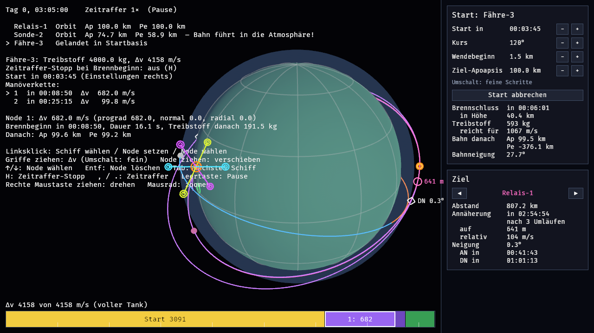

*Fähre-3 zu Relais-1 (rosa): Start im Startfenster (Kurs 120°, Neigung zum
Ziel 0,3°), Node 1 macht die Bahn auf 100 km rund, Node 2 hebt sie leicht
an, damit die Fähre aufholt. Nach drei Umläufen kommt sie Relais-1 auf
etwa 600 m nahe (Ringe mit Linie). Nachspielen mit den Optionen unten.*

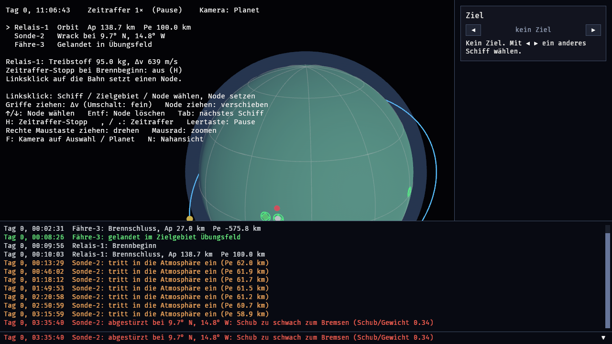

*Nach elf Stunden Spielzeit: Die aufgeklappte Statusleiste zeigt den Hop der
Fähre ins Übungsfeld, ein Manöver von Relais-1 und wie Sonde-2 von Umlauf zu
Umlauf tiefer in die Luft taucht, bis sie abstürzt.*

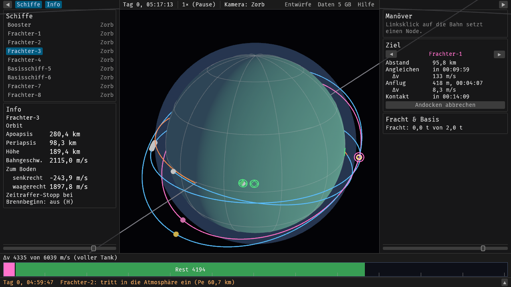

*Fähre-3 vor dem Andocken an Relais-1: In 10 Minuten gleicht sie an der
engsten Stelle (624 m) mit 110 m/s an, fliegt in 6 Minuten heran (7 m/s) und
hat danach noch gut 160 m/s.*

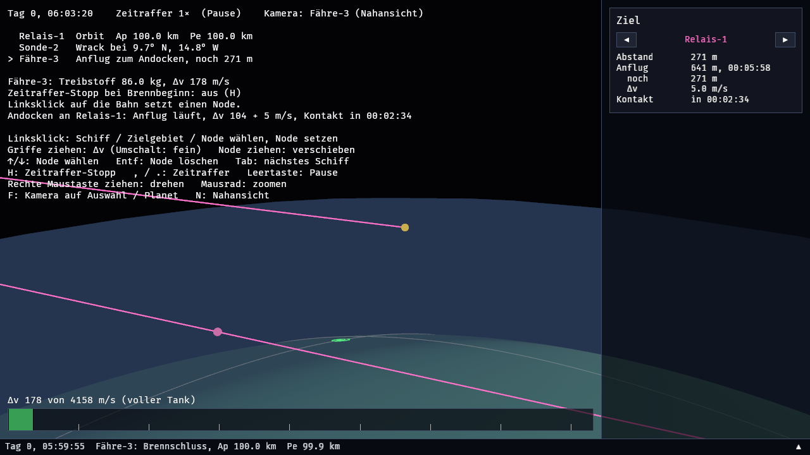

*Im Anflug, aus der Nähe: Fähre-3 (gelb) ist noch 271 m von Relais-1 (rosa)
entfernt, Kontakt in zweieinhalb Minuten.*

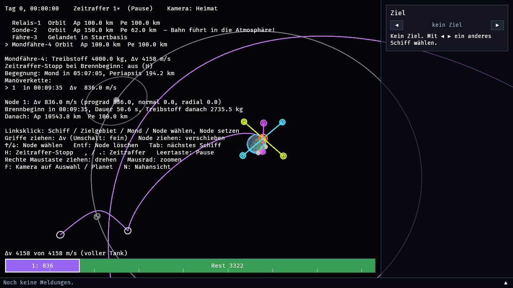

*Mondfähre-4 mit geplantem Transfer (`--node 3,600,836,0,0 --select 3
--camera 20,60,26000`): violett die Bahn zum Mond, unten links das Stück um
den Geistermond mit Ein- und Austritt, danach die neue Bahn um den Planeten.*

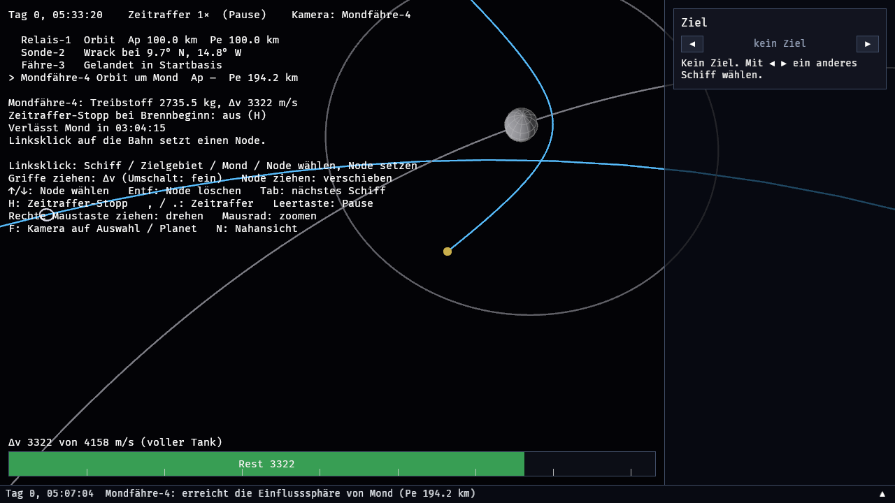

*Im Vorbeiflug (`--node 3,600,836,0,0 --time 20000 --select 3 --focus 3
--camera 120,70,7000`): Bahn um den Mond, Periapsis 194 km.*

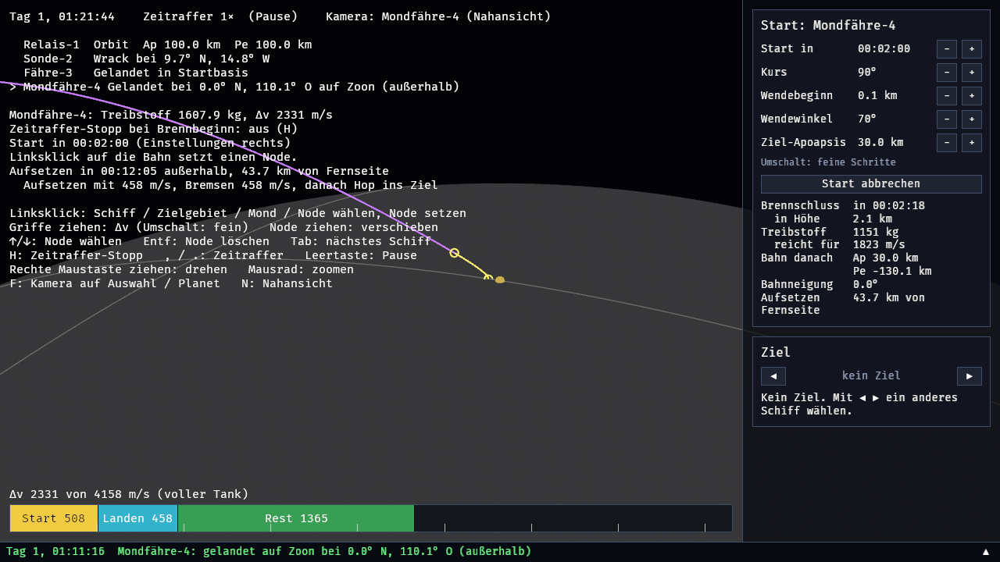

*Mondfähre-4 nach der Landung auf Zoon, Start geplant mit der Voreinstellung
ohne Luft (Wende ab 100 m mit 70°, Ziel 30 km). Nachspielen mit
`--demo --node 3,600,836,0,0 --node 3,24740,-380,0,0 --time 26500 --select 3
--focus 3 --near --camera 20,25,60` und „Start planen“.*

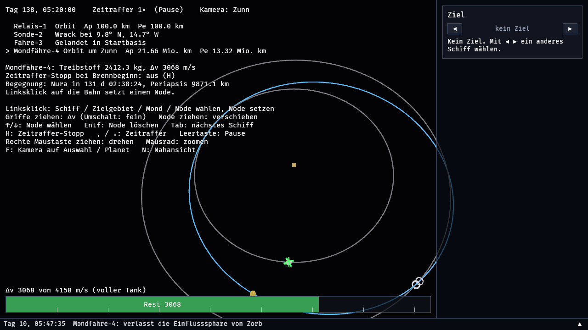

*Mondfähre-4 (gelb, unten) auf dem Weg nach Nura: Zunn in der Mitte, innen
Zorbs Bahn (die grüne Markierung sind Zorbs Zielgebiete), außen die von
Nura. Die blaue Bahn um die Sonne führt in Nuras Einflusssphäre (Ringe
rechts unten), links steht die Begegnung in 131 Tagen. Nachspielen mit `--demo --node 3,163400,1090,0,0 --time 3000000
--select 3 --focus-body 0 --camera 30,60,55000000`.*

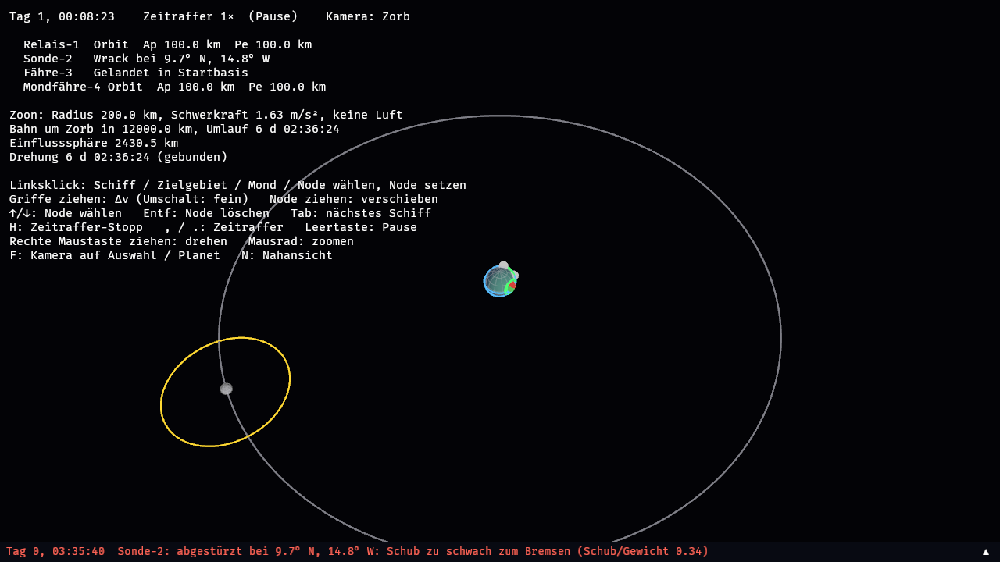

*Der Mond ist gewählt: Bahn um den Planeten, Einflusssphäre gelb, links seine
Angaben. Nachspielen mit `--demo --time 22100 --camera 30,50,30000` und einem Klick
auf den Mond.*

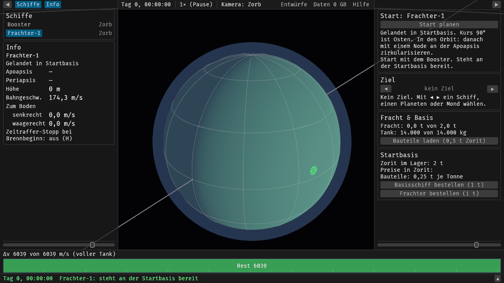

*Spielbeginn: Der bestellte Frachter-1 steht vollgetankt an der Startbasis.
Die Karte „Startbasis“ zeigt das Zorit im Lager und die Preise, „Fracht &
Basis“ den Preis für eine Ladung Bauteile.*

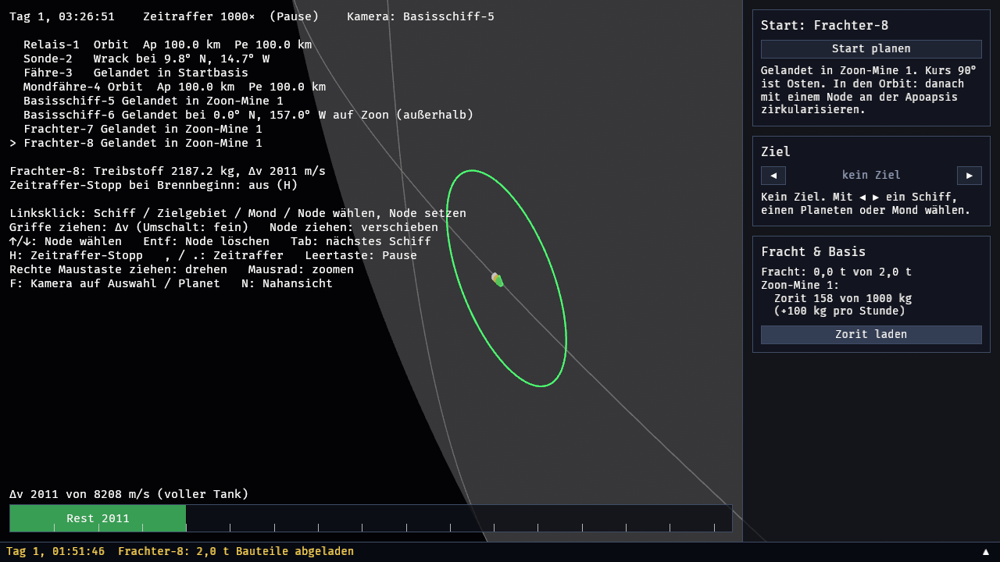

*Zoon-Mine 1 ist fertig: Basisschiff-5 ist das Fundament, beide Frachter
haben abgeladen. Die Karte „Fracht & Basis“ zeigt das Lager der Mine; mit
„Zorit laden“ nimmt Frachter-8 mit, was da ist. Der grüne Kreis ist die Zone
der Basis (5 km).*

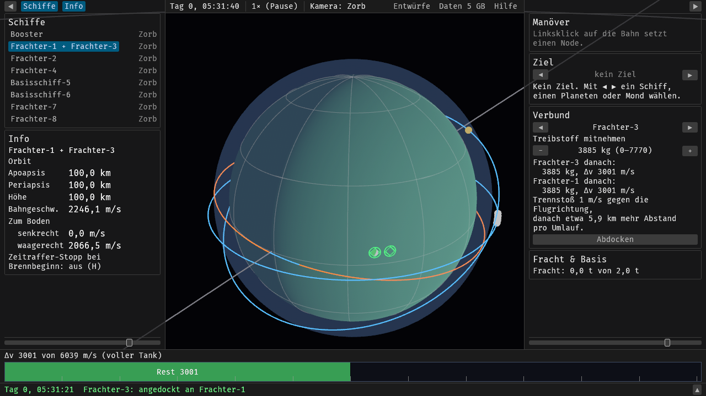

*Nach dem Kontakt: Relais-1 und Fähre-3 sind ein Verbund mit gemeinsamem Tank.
Die Karte „Verbund“ schlägt vor, wie viel Treibstoff Fähre-3 beim Abdocken
mitnimmt, und zeigt, was beide danach haben.*

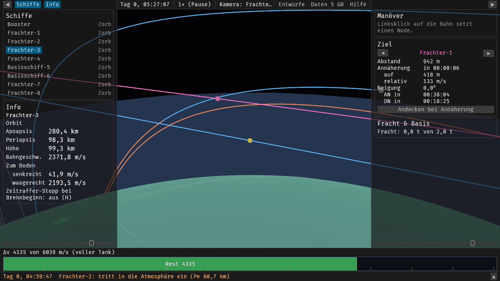

*Nahansicht beim Rendezvous aus dem Bild darüber: Kamera auf Fähre-3 (gelb),
Relais-1 (rosa) ist 912 m entfernt, die engste Annäherung kommt in 6 s.*

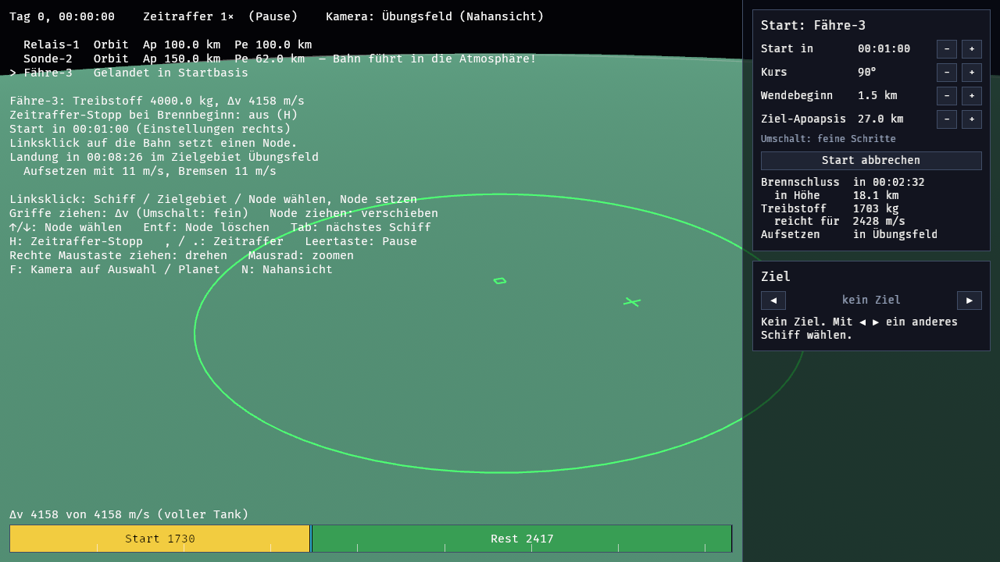

*Kamera auf das Übungsfeld in der Nahansicht, aus 12 km: Das Kreuz zeigt,
wo der geplante Hop der Fähre aufsetzt.*

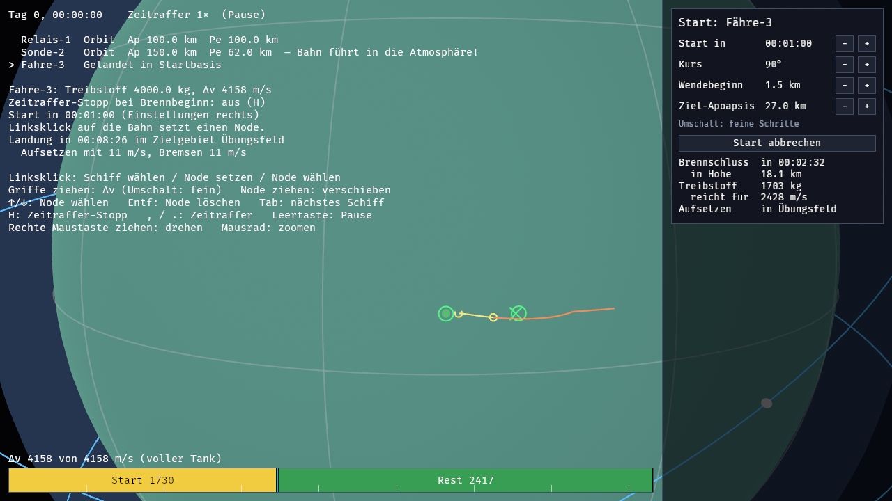

*Hop der Fähre von der Startbasis (links) zum Übungsfeld: Aufstieg gelb,
Flug durch die Luft orange, das grüne Kreuz liegt im Zielgebiet. Die Bahn ist
ohne Drehung des Planeten gezeichnet, das Kreuz zeigt den genauen Punkt auf
der Oberfläche.*

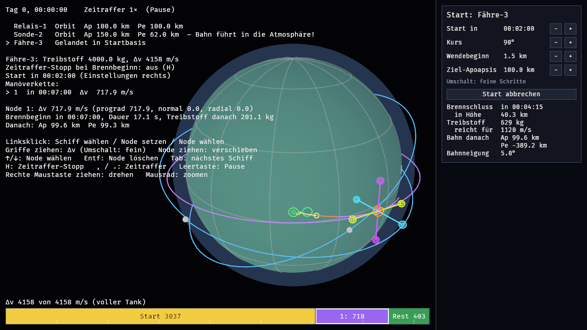

*Fähre-3 vor dem Start: Aufstieg nach Osten (gelb), Freiflug durch die obere
Luft (orange), dazu ein Node an der Apoapsis, der die Bahn auf 99 km rund
macht. Rechts die Karte „Start“.*

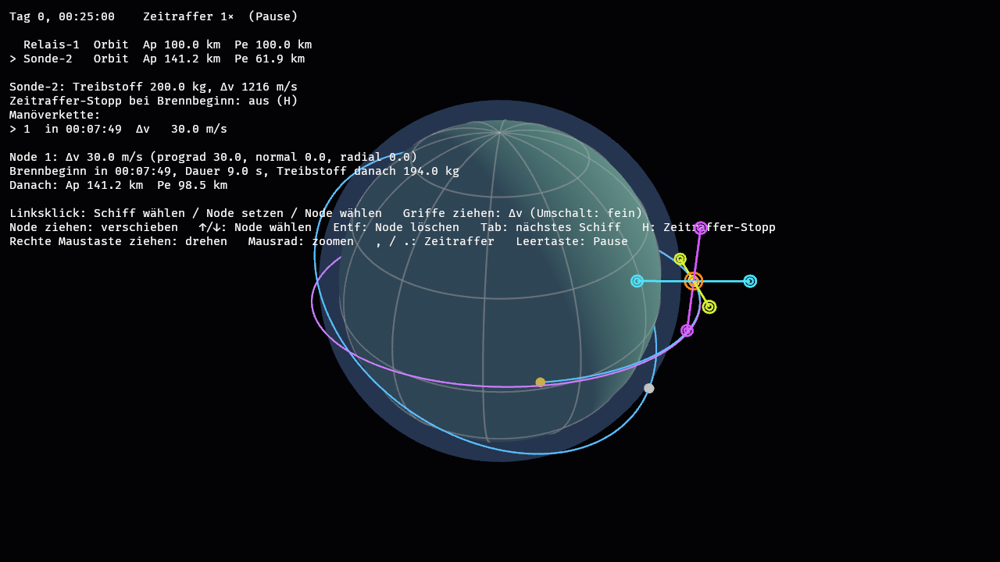

*Rettung von Sonde-2: Node an der Apoapsis, 30 m/s prograd. Blau die aktuelle
Bahn, violett die Bahn danach.*

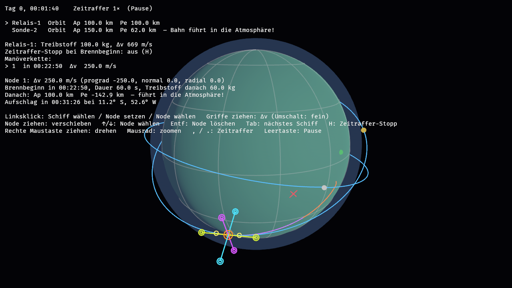

*Relais-1 bremst ab: Die Bahn führt durch die Luft (orange) auf den Boden. Ein
Satellit hat zu wenig Schub zum Abbremsen, das rote Kreuz markiert den
Absturz.*

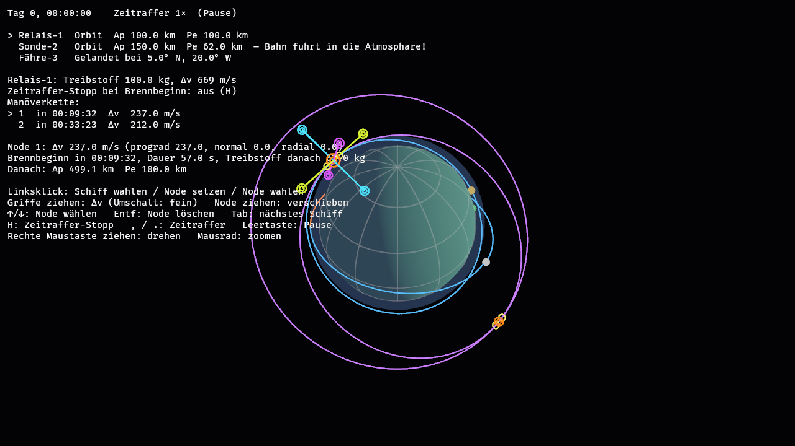

*Hohmann-Übergang von 100 auf 500 km als Kette aus zwei Nodes: Der erste
(gewählt, mit Griffen) hebt die Apoapsis, der zweite liegt auf der violetten
Übergangsbahn an der Apoapsis und macht die Bahn rund.*

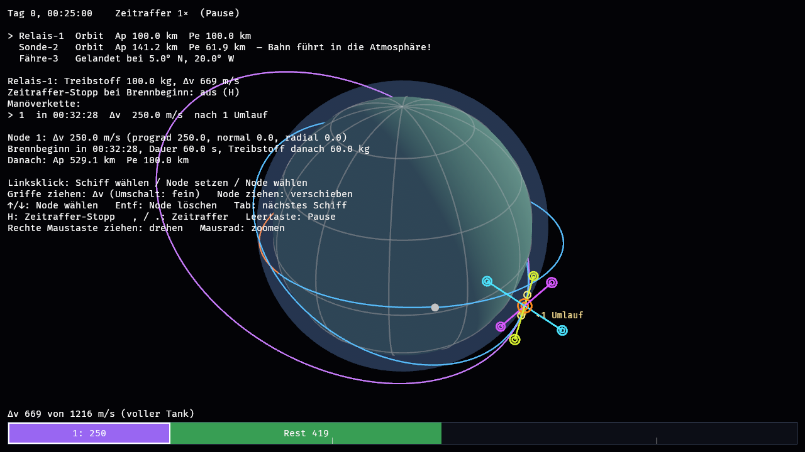

*Node mit 250 m/s prograd, 20 s vor Relais-1 gesetzt. Das Brennen bräuchte
30 s Vorlauf, also liegt der Node einen Umlauf später; das Etikett „+1 Umlauf“
zeigt es an.*

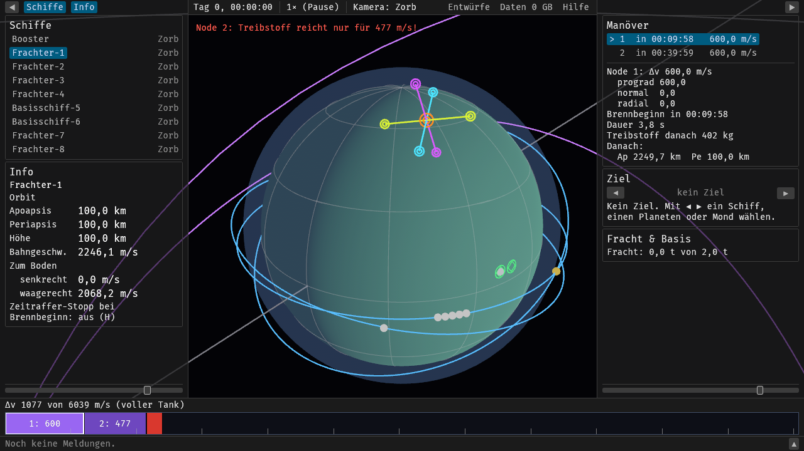

*Relais-1 hat noch 669 m/s an Bord (von 1216 m/s mit vollem Tank). Die Kette
will zweimal 400 m/s: Der zweite Node bekommt nur 269 m/s, 131 m/s fehlen.*

## Starten

Voraussetzung: Rust ≥ 1.97.1 (`rustup update`). Unter Linux die
[Systempakete für Bevy](https://github.com/bevyengine/bevy/blob/main/docs/linux_dependencies.md)
(Audio- und Gamepad-Pakete werden nicht gebraucht).

```sh
cargo run -p game
```

Der erste Build dauert einige Minuten, danach geht es schnell.

### Steuerung

| Eingabe | Wirkung |
|---|---|
| Rechte Maustaste ziehen | Kamera drehen |
| Mausrad | Zoomen (über dem aufgeklappten Protokoll: scrollen) |
| ▲ / ▼ rechts in der Statusleiste | Protokoll auf- und zuklappen (Scrollleiste ziehbar) |
| Linksklick auf ein Schiff / `Tab` | Schiff wählen / nächstes Schiff |
| Linksklick auf die Raute in einem Zielgebiet | Zielgebiet wählen |
| Linksklick auf den Mond | Mond wählen (eine Bahn davor geht vor: Node setzen) |
| `F` | Kamera auf die Auswahl (Node, Schiff, Zielgebiet, Mond; ohne Auswahl Planet); nochmal `F` zurück zum Planeten |
| `N` | Nahansicht an/aus (Planet unten, Zoom bis 10 m; nur mit einem Objekt im Fokus) |
| Seitenleiste „Start“ (gelandetes Schiff gewählt) | Start planen / abbrechen; −/+ ändern Startzeit, Kurs, Wendebeginn, Wendewinkel, Ziel-Apoapsis (`Umschalt`: feine Schritte) |
| Seitenleiste „Ziel“ ◄ ► | Ziel für ein Rendezvous wählen (anderes Schiff oder keins) |
| Seitenleiste „Ziel“: Andocken bei Annäherung | Andocken als letzten Schritt der Kette planen / abbrechen |
| Seitenleiste „Verbund“ | Teil wählen (◄ ►), Treibstoff zum Mitnehmen (− / +, `Umschalt`: fein), Abdocken |
| Seitenleiste „Startbasis“ (Schiff an der Startbasis oder ihr Zielgebiet gewählt) | Zorit im Lager, Preise; „Basisschiff bestellen“, „Frachter bestellen“ |
| Seitenleiste „Fracht & Basis“ (Frachter, Basisschiff oder Schiff an einer Basis gewählt) | Fracht, Baustelle und Lager; je nach Lage „Mine gründen“ / „Tankstelle gründen“, „Bauteile abladen“, „Tanken“, „Zorit laden“, an der Startbasis „Bauteile laden“, „Tanken“, „Zorit abladen“ |
| Linksklick auf die Bahn des gewählten Schiffs | Node setzen (auch auf die Bahn nach einem geplanten Manöver) |
| Linksklick auf einen Node / `↑` `↓` | Node wählen (nur der gewählte hat Griffe) |
| Griff ziehen | Δv in diese Richtung ändern (je weiter, desto schneller; `Umschalt`: fein; höchstens bis der Tank leer ist) |
| Node ziehen | Node entlang seiner Bahn verschieben; spätere Nodes wandern mit. Auf einer Bahn durch die Luft kommt er nach innen gezogen auf einen späteren Umlauf („+N Umläufe“) |
| `Entf` / `Rücktaste` | gewählten Node löschen |
| `F5` / `F9` | Spielstand speichern / laden (siehe unten) |
| `H` | Zeitraffer-Stopp für das gewählte Schiff an/aus: Beginnt es zu brennen, hält der Zeitraffer genau dort an und schaltet auf 1× |
| `Esc` | Auswahl aufheben |
| `.` / `,` | Zeitraffer schneller / langsamer (1× bis 1 000 000×) |
| Leertaste | Pause |

Griffe: gelbgrün prograd/retrograd, violett normal/antinormal, türkis radial
nach außen/innen.

### Optionen

```sh
cargo run -p game -- --demo --node 0,600,237,0,0 --node 0,2027,212,0,0 --camera -30,50,4200
```

- `--time SEKUNDEN`: bis zu dieser Spielzeit vorrechnen; Start, Nodes und Ziel
  gelten ab Spielbeginn und werden dabei ausgeführt
- `--camera GIER,NEIGUNG,KM`: Blickwinkel in Grad, Abstand vom Fokus in km
- `--focus SCHIFF` / `--focus-zone ZIELGEBIET`: Kamera auf ein Schiff bzw.
  Zielgebiet (0 = Startbasis, 1 = Übungsfeld, 2 = Messfeld Ost)
- `--focus-body KÖRPER`: Kamera auf einen Himmelskörper (0 = Zunn, 1 = Zorb,
  2 = Zoon, 3 = Zill, 4 = Nura)
- `--near`: Nahansicht (mit `--focus` oder `--focus-zone`)
- `--load DATEI`: einen Spielstand laden statt neu zu beginnen
- `--demo`: die Demo mit Schiffen laden (siehe oben)
- `--dock SCHIFF`: Andocken an das Ziel einschalten (nach `--target`)
- `--select SCHIFF`: Schiff wählen (0 = Relais-1, 1 = Sonde-2, 2 = Fähre-3)
- `--launch SCHIFF,ZEIT,KURS,WENDE_KM,AP_KM[,WENDEWINKEL]`: Start planen
  (Zeitpunkt des Abhebens in s, Kurs und Wendewinkel in Grad; ohne
  Wendewinkel die Voreinstellung des Körpers), z. B. `--launch 2,120,90,2,100`
- `--node SCHIFF,ZEIT,PROGRAD,NORMAL,RADIAL[,SCHARF]`: Node setzen (Zeit in s,
  Δv in m/s), mehrfach für eine Kette; scharf wie im Spiel, `SCHARF` = 0 lässt
  die Kette zum Testen nicht scharf
- `--target SCHIFF,ZIEL`: Ziel für ein Rendezvous setzen
- `--target-body SCHIFF,KÖRPER`: Himmelskörper als Ziel setzen (Nummern wie
  bei `--focus-body`)
- `--screenshot DATEI.png`: Bild speichern und beenden (Zeit steht dabei still)

Rendezvous Fähre-3 → Relais-1 aus dem Bild oben (Start im Startfenster,
Zirkularisieren, Aufholen):

```sh
cargo run -p game -- --demo --time 11100 --launch 2,11299,120,1.5,100 --target 2,0 \
  --node 2,11612,682,0,0 --node 2,12590,102.25,0,0
```

Mit Andocken (`--dock 2`) und dann mitten im Anflug aus der Nähe (Bild
„Andocken aus der Nähe“):

```sh
cargo run -p game -- --demo --time 21772 --launch 2,11299,120,1.5,100 --target 2,0 \
  --node 2,11612,682,0,0 --node 2,12590,102.25,0,0 --dock 2 --focus 2 --near --camera 40,20,0.6
```

Dasselbe ohne Andocken kurz vor der Annäherung in der Nahansicht (Bild „Nahansicht“):

```sh
cargo run -p game -- --demo --time 21570 --launch 2,11299,120,1.5,100 --target 2,0 \
  --node 2,11612,682,0,0 --node 2,12590,102.25,0,0 --focus 2 --near --camera 50,25,6
```

## Speichern und Laden

`F5` speichert, `F9` lädt. Es gibt einen Spielstand: die Datei
`spielstand.json` in dem Ordner, aus dem das Spiel gestartet wurde. Beim
Speichern bleibt der vorherige Stand als `spielstand.vorher.json` erhalten,
falls man einen guten Stand überschreibt (zum Zurückholen die Datei
umbenennen oder mit `--load spielstand.vorher.json` starten).

Gespeichert wird die ganze Welt: Zeit, Schiffe mit Bahnen und geplanten
Manövern, Fracht, Basen, Lager, Zorit und das Protokoll. Ein Flug geht nach
dem Laden exakt so weiter wie ohne Speichern. Kamera, Auswahl und Zeitraffer
gehören nicht dazu; nach dem Laden ist das Spiel pausiert. Es wird nie von
selbst gespeichert oder geladen: Das Spiel beginnt immer neu, `F9` holt den
Stand. Spielstände älterer Versionen des Spiels werden nicht geladen (eine
Meldung nennt die Versionen).

## Tests

```sh
cargo test -p sim
```

Die Simulation hat keine Abhängigkeit zu Bevy, die Tests kompilieren und laufen
in Sekunden.

## Aufbau

- `crates/sim`: Simulation (Bahnen, Atmosphäre, Manöver, Start, Landung, Rendezvous, Fracht und Basen, Zeitleiste, Spielstand)
- `crates/game`: Darstellung und Eingabe mit Bevy (Anzeige links, Seitenleiste rechts)
- `docs/ARCHITEKTUR.md`: Regeln, Physikmodell, Entscheidungen, Merkliste
